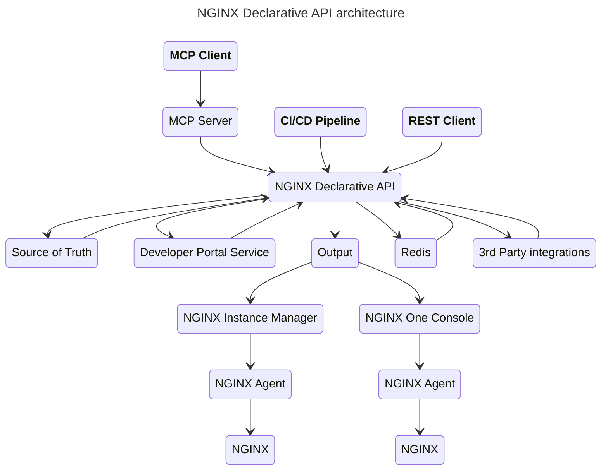
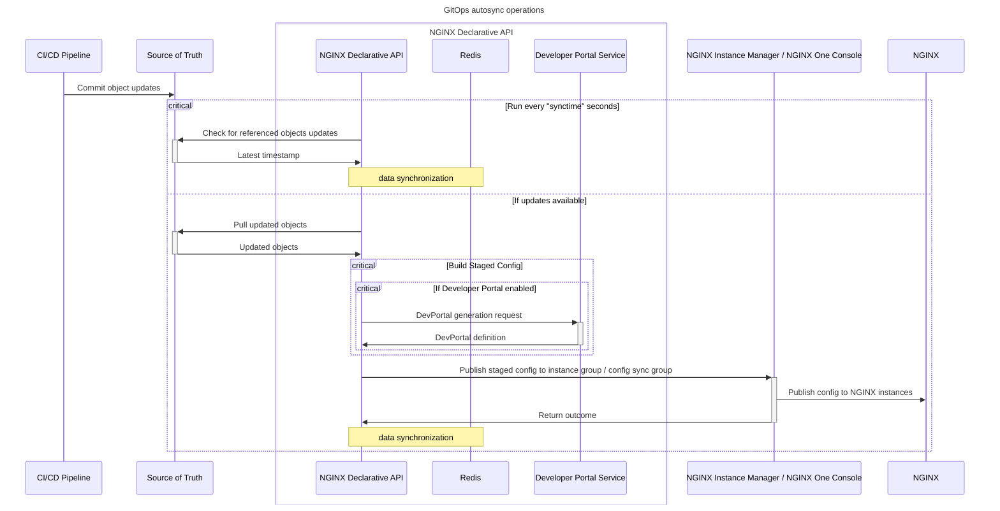
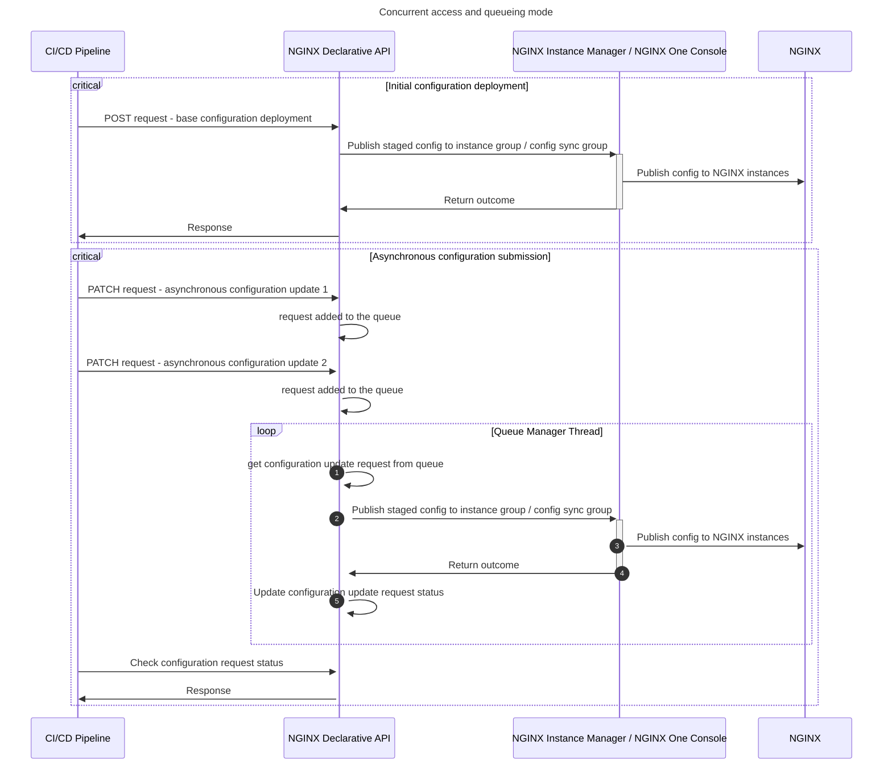

# Architecture

This document describes the high-level architecture and operational workflows of the **NGINX Declarative API**.

> For a feature overview, GitOps & API Gateway use cases, and quickstart instructions, see [README.md](/README.md).

---

## System Overview

The NGINX Declarative API translates a single high-level JSON declaration describing your intended outcome into validated NGINX configurations, auxiliary files, Developer Portal artifacts, and control plane deployments.

### Key Components

| Component | Role |
| --- | --- |
| **Clients (`REST Client`, `CI/CD Pipeline`, `MCP Client`)** | Submit declarative JSON payloads, incremental `PATCH` updates, or natural-language operations (via the [MCP Server](/contrib/mcp)) over REST. |
| **NGINX Declarative API** | Validates declarations against versioned Pydantic schemas, fetches external references, renders NGINX/WAF configurations, and manages publishing workflows. |
| **Source of Truth (`SOT`)** | External HTTP(S)/GitOps endpoints hosting OpenAPI/Swagger specs, F5 WAF policies, TLS certificates/keys/chains, snippets, and `njs` scripts. |
| **Redis** | Persists declaration state, submission statuses, timestamps/metadata for GitOps autosync, and the asynchronous request queue. |
| **Developer Portal Service** | Generates API developer portal artifacts (Redocly HTML bundles or Backstage manifests) from imported OpenAPI schemas. |
| **3rd Party Integrations** | Integrates external tooling such as API visibility backends (Moesif). |
| **Output (`NGINX Instance Manager` / `NGINX One Console`)** | Publishes staged configurations and auxiliary files to target instance groups or config sync groups, where **NGINX Agent** applies them to **NGINX** instances. |

---

## GitOps Autosync Mode

When `synctime` is configured under `.output.nms.synctime` or `.output.nginxone.synctime`, NGINX Declarative API periodically checks all HTTP(S)-referenced Source of Truth artifacts (OpenAPI/Swagger schemas, F5 WAF for NGINX policies, TLS certificates/keys/chains, configuration snippets, and `njs` files). Whenever an upstream artifact changes, configurations are rebuilt and republished automatically without manual API calls.

---

## Concurrent Access and Queueing Mode

For concurrent CI/CD pipelines updating a shared configuration via `PATCH`, setting `.output.<target>.synchronous` to `false` switches submissions to asynchronous queued execution. Requests are serialized by the internal queue manager and callers can poll `GET /v5.7/config/{configUid}/submission/{submissionUid}` for completion status.

---

## Related Documentation

- [README.md](/README.md) — Overview, outcome-driven examples, GitOps & API Gateway use cases, deployment, and testing
- [FEATURES.md](/FEATURES.md) — Complete feature matrix across API versions and OpenAPI specification support
- [USAGE-v5.7.md](/USAGE-v5.7.md) — Declaration schema reference and REST endpoints for API v5.7
