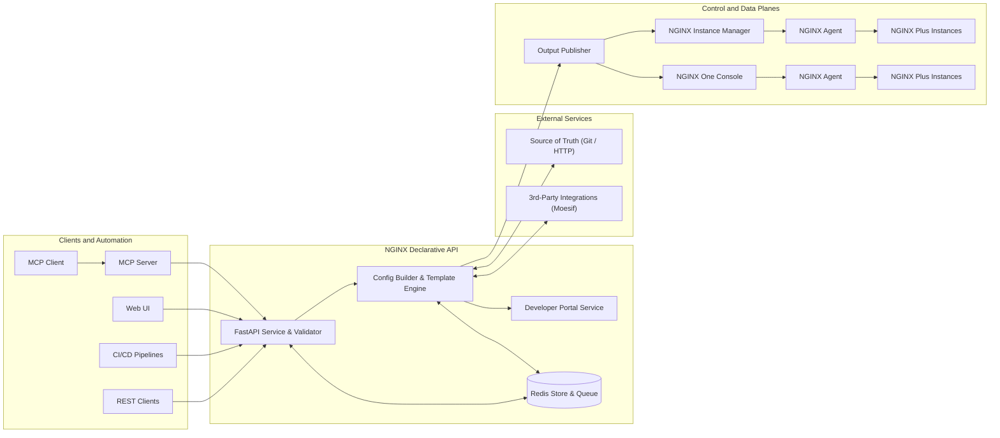
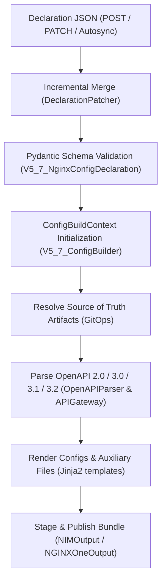
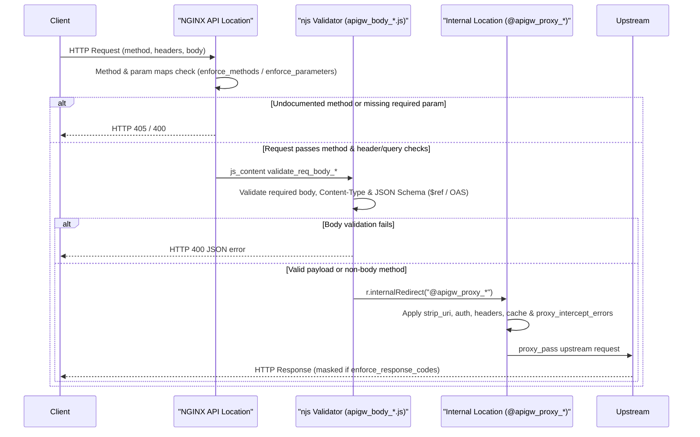
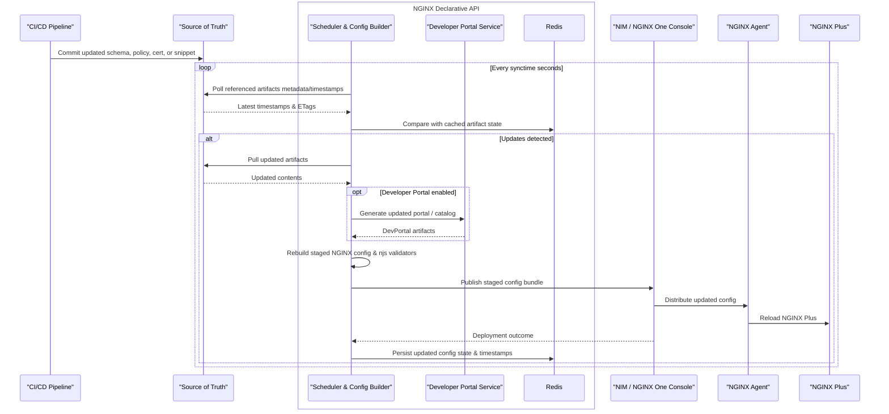
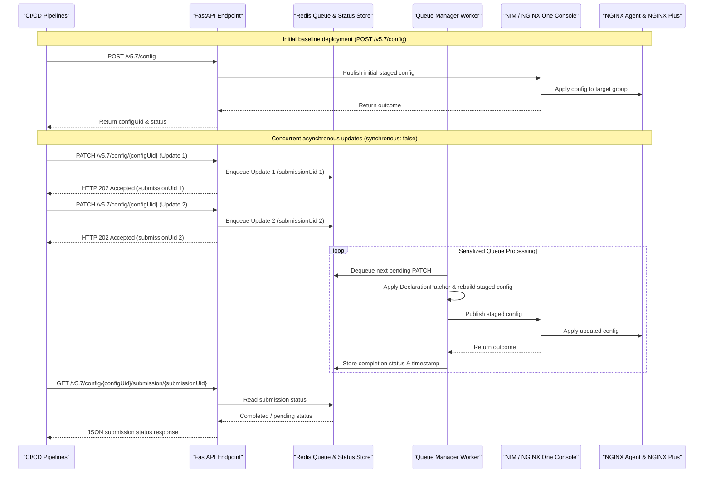

# Architecture

This document describes the system architecture, rendering pipeline, and operational workflows of the **NGINX Declarative API**.

> For a feature overview, quickstart examples, and deployment instructions, see [README.md](/README.md).

## Table of Contents

- [System Overview](#system-overview)
  - [Key Components](#key-components)
- [Configuration Rendering Pipeline](#configuration-rendering-pipeline)
- [API Gateway Runtime Request Flow](#api-gateway-runtime-request-flow)
- [GitOps Autosync Mode](#gitops-autosync-mode)
- [Concurrent Access and Queueing Mode](#concurrent-access-and-queueing-mode)
- [Related Documentation](#related-documentation)

---

## System Overview

NGINX Declarative API accepts high-level JSON declarations (as well as incremental `PATCH` updates), resolves any external Sources of Truth, compiles complete NGINX Plus configurations and auxiliary artifacts, and publishes staged bundles to your NGINX control plane.

### Key Components

| Component | Role |
| --- | --- |
| **Clients (`REST`, `CI/CD`, `Web UI`, `MCP Server`)** | Submit full declarations (`POST`), incremental updates (`PATCH`), or natural-language operations (via [`contrib/mcp`](/contrib/mcp) and [`webui`](/webui)) over REST. |
| **FastAPI Service & Validator (`src/main.py`)** | Exposes versioned endpoints (`/v5.5`, `/v5.6`, `/v5.7`), validates declarations against Pydantic schemas, and routes asynchronous `PATCH` requests through the queue manager. |
| **Config Builder & Template Engine** | Resolves external artifacts, parses OpenAPI/Swagger specs, renders NGINX/WAF configuration files and `njs` modules via Jinja2, and packages staged config bundles. |
| **Redis Store & Queue (`src/NcgRedis.py`)** | Stores active declarations, submission job statuses, autosync artifact metadata/timestamps, and serialized asynchronous `PATCH` queues. |
| **Source of Truth (`SOT`)** | External HTTP(S) or Git endpoints hosting OpenAPI/Swagger schemas, F5 WAF for NGINX policies, TLS certificates/keys/chains, snippets, and custom `njs` scripts. |
| **Developer Portal Service (`src/v5_7/DevPortal.py`)** | Builds Redocly developer portal HTML bundles or Backstage catalog YAML manifests from referenced OpenAPI specs. |
| **3rd-Party Integrations** | Instruments API Gateways with external visibility/telemetry providers such as Moesif. |
| **Output Publishers (`NIMOutput` / `NGINXOneOutput`)** | Deploy staged configurations and auxiliary files (`njs`, TLS certs, MIME types) to NGINX Instance Manager instance groups or NGINX One Console config sync groups, where NGINX Agent applies them to NGINX Plus. |

---

## Configuration Rendering Pipeline

In API **v5.7**, every `POST /v5.7/config`, `PATCH /v5.7/config/{configuid}`, or autosync rebuild passes through a deterministic compilation pipeline before publishing:

| Stage | Primary Modules (`src/`) | Output Produced |
| --- | --- | --- |
| **API & Queue Routing** | `main.py`, `v5_7/Asynchronous.py` | Immediate execution or queued submission UID for `/v5.7/config/{configuid}/submission/{submissionuid}` |
| **Patching & Validation** | `v5_7/DeclarationPatcher.py`, `V5_7_NginxConfigDeclaration.py` | Validated `.output` and `.declaration` objects (`v5.7` Pydantic models) |
| **Artifact Fetching & Parsing** | `v5_7/GitOps.py`, `v5_7/OpenAPIParser.py`, `v5_7/APIGateway.py` | Dereferenced OpenAPI paths, operations, parameters, response codes, `requestBody` schemas, and `$ref` definitions |
| **Config & `njs` Generation** | `V5_7_ConfigBuilder.py`, `templates/v5.7/*.tmpl` | `nginx.conf`, `http.conf`, `stream.conf`, server/upstream/map files, `@apigw_proxy_*` internal locations, and `apigw_body_*.js` validators in `auxFiles` |
| **Control Plane Publishing** | `v5_7/NIMOutput.py`, `v5_7/NGINXOneOutput.py`, `v5_7/NIMNAPUtils.py`, `v5_7/NGINXOneNAPUtils.py` | Staged deployment with automatic `ngx_http_js_module` loading when generated body validators are present |

---

## API Gateway Runtime Request Flow

When `api_gateway.enforce_bodies` is enabled (`true` by default) in API v5.7 and an endpoint defines a resolvable OpenAPI request body schema, generated NGINX locations delegate payload validation to NGINX JavaScript (`njs`) before proxying upstream:

Endpoints without request body schemas (or deployments with `enforce_bodies: false`) skip the `njs` phase and proxy directly inside the endpoint `location` block.

---

## GitOps Autosync Mode

When `synctime` is configured under `.output.nms.synctime` or `.output.nginxone.synctime`, a background scheduler in `V5_7_CreateConfig.py` periodically polls every HTTP(S)-referenced Source of Truth artifact (OpenAPI specs, F5 WAF policies, TLS certificates/keys/chains, snippets, and `njs` scripts). Any detected upstream change triggers an automatic rebuild and staged deployment.

---

## Concurrent Access and Queueing Mode

For CI/CD pipelines issuing concurrent updates against a shared configuration (`PATCH /v5.7/config/{configuid}`), setting `.output.synchronous` to `false` switches updates to Redis-backed queued execution. Callers receive a submission identifier immediately and can poll `GET /v5.7/config/{configuid}/submission/{submissionuid}` for completion status.

---

## Related Documentation

- [README.md](/README.md) — Overview, outcome-driven examples, GitOps & API Gateway use cases, deployment, and testing
- [FEATURES.md](/FEATURES.md) — Complete feature matrix, Request Body Schema Validation reference, and OAS support details
- [USAGE-v5.7.md](/USAGE-v5.7.md) — REST endpoints and JSON schema reference for API `v5.7`
