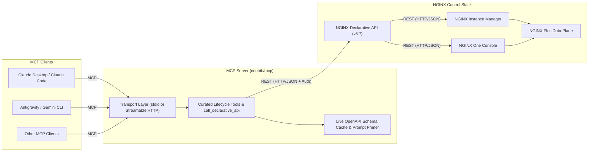

# NGINX Declarative API — MCP Server

This module provides a **Model Context Protocol (MCP) server** that enables LLMs and AI coding assistants (Claude Desktop, Claude Code, Google Antigravity, Gemini CLI, or any MCP-compatible client) to manage the [NGINX Declarative API](https://github.com/f5devcentral/NGINX-Declarative-API) using natural language instead of hand-authoring JSON declarations and REST requests.

It is a thin, stateless MCP bridge that sits in front of an already-running NGINX Declarative API instance and communicates with it over HTTP/JSON:



## Table of Contents

- [Architecture and Design Principles](#architecture-and-design-principles)
- [Installation and Deployment](#installation-and-deployment)
  - [Option A: Local Python Process (stdio)](#option-a-local-python-process-stdio)
  - [Option B: Container Deployment (streamable-http)](#option-b-container-deployment-streamable-http)
- [Client Configuration](#client-configuration)
- [Configuration Reference](#configuration-reference)
- [Exposed MCP Tools and Prompts](#exposed-mcp-tools-and-prompts)
- [Example Natural-Language Prompts](#example-natural-language-prompts)
- [MCP SDK Compatibility and Testing](#mcp-sdk-compatibility-and-testing)
- [Security Notes](#security-notes)

---

## Architecture and Design Principles

Rather than hard-coding the full `v5.7` declaration JSON Schema inside the MCP server—which would drift whenever new capabilities are added—this bridge:

1. **Grounds against the live OpenAPI schema (`GET /openapi.json`):** `get_api_schema` fetches and caches the schema directly from your running Declarative API instance so the model always sees the exact fields supported by the target deployment.
2. **Provides curated lifecycle tools:** High-level tools cover declaration creation (`POST /v5.7/config`), incremental patching (`PATCH /v5.7/config/{configUid}`), inspection (`GET /v5.7/config`, `GET /v5.7/config/{configUid}`), deletion (`DELETE /v5.7/config/{configUid}`), and async submission polling (`GET /v5.7/config/{configUid}/submission/{submissionUid}`).
3. **Validates locally before submitting:** `validate_declaration_locally` performs fast JSON syntax and required-structure checks before sending requests upstream.
4. **Includes a schema-aware escape hatch (`call_declarative_api`):** Supports any current or future REST path/method on the configured Declarative API instance (such as WAF policy, certificate, status, or developer portal operations).
5. **Adapts across `v5.x` releases:** Switch target API versions simply by changing `NDAPI_VERSION`.

---

## Installation and Deployment

### Option A: Local Python Process (`stdio`)

Recommended for local desktop and CLI MCP clients (Claude Desktop, Claude Code, Antigravity, Gemini CLI):

```bash
cd contrib/mcp
python3 -m venv .venv
source .venv/bin/activate
pip install -r requirements.txt
cp .env.example .env   # Configure NDAPI_BASE_URL and credentials
python -m nginx_declarative_api_mcp.server
```

Register the server by copying the snippet from [`examples/claude_desktop_config.stdio.json`](examples/claude_desktop_config.stdio.json) (or [`examples/antigravity_mcp_config.stdio.json`](examples/antigravity_mcp_config.stdio.json)) into your client configuration.

### Option B: Container Deployment (`streamable-http`)

Recommended for shared team environments or remote MCP connectors:

- Deploy alongside the API stack using [`contrib/docker-compose`](/contrib/docker-compose) or build directly with [`Dockerfile`](Dockerfile).
- By default, the HTTP server listens on `http://<host>:8800/mcp` and accepts connections via the MCP Streamable HTTP transport.

---

## Client Configuration

Ready-to-edit client snippets and setup walkthroughs are maintained in [`examples/README.md`](examples/README.md):

| Client | `stdio` Transport | `streamable-http` Transport |
| --- | --- | --- |
| **Claude Desktop / Claude Code** | [`claude_desktop_config.stdio.json`](examples/claude_desktop_config.stdio.json) | [`claude_desktop_config.http.json`](examples/claude_desktop_config.http.json) *(via `mcp-remote` bridge or Connectors)* |
| **Antigravity / Gemini CLI** | [`antigravity_mcp_config.stdio.json`](examples/antigravity_mcp_config.stdio.json) | [`antigravity_mcp_config.http.json`](examples/antigravity_mcp_config.http.json) *(native `serverUrl`)* |

---

## Configuration Reference

All settings are loaded from environment variables (see [`.env.example`](.env.example)):

| Variable | Default | Description |
| --- | --- | --- |
| `NDAPI_BASE_URL` | `http://localhost:5000` | Base URL of the running NGINX Declarative API instance (no trailing slash) |
| `NDAPI_VERSION` | `v5.7` | API version path segment (`/v5.7/...`) |
| `NDAPI_AUTH_MODE` | `none` | Upstream authentication mode: `none`, `basic`, or `apikey` |
| `NDAPI_USERNAME` / `NDAPI_PASSWORD` | — | Credentials used when `NDAPI_AUTH_MODE=basic` |
| `NDAPI_API_KEY` | — | Bearer token used when `NDAPI_AUTH_MODE=apikey` (`Authorization: Bearer <key>`) |
| `NDAPI_TIMEOUT_SECONDS` | `30` | HTTP client request timeout in seconds |
| `NDAPI_VERIFY_TLS` | `true` | Set to `false` to allow self-signed certificates in lab environments |
| `MCP_TRANSPORT` | `stdio` | MCP transport mode: `stdio` or `streamable-http` |
| `MCP_HTTP_HOST` | `0.0.0.0` | Bind address when `MCP_TRANSPORT=streamable-http` |
| `MCP_HTTP_PORT` | `8800` | Listen port when `MCP_TRANSPORT=streamable-http` |

---

## Exposed MCP Tools and Prompts

### Tools

| Tool | Parameters | Purpose |
| --- | --- | --- |
| `get_api_schema` | `force_refresh: bool = False` | Fetch or refresh the live OpenAPI schema from the connected Declarative API instance |
| `list_declarations` | — | List active declaration `configUid` entries managed by the instance |
| `get_declaration` | `config_uid: str` | Retrieve an existing declaration by `configUid` |
| `validate_declaration_locally` | `declaration_json: dict` | Validate declaration structure and required top-level fields prior to submission |
| `create_declaration` | `declaration_json: dict` | Submit a new declaration (`POST /v5.7/config`) |
| `update_declaration` | `config_uid: str`, `declaration_json: dict` | Incrementally patch/update an existing declaration (`PATCH /v5.7/config/{configUid}`) |
| `delete_declaration` | `config_uid: str` | Delete an existing declaration (`DELETE /v5.7/config/{configUid}`) |
| `get_submission_status` | `config_uid: str`, `submission_uid: str` | Poll the status of an asynchronous queued `PATCH` submission |
| `call_declarative_api` | `method`, `path`, `body`, ... | Schema-grounded escape hatch to invoke any REST path on `NDAPI_BASE_URL` |

### Prompts

- **`declarative-api-primer`:** Supplies a concise structural guide to `.output.nms` / `.output.nginxone`, `.declaration`, Source of Truth URLs, and GitOps `synctime` so the LLM composes valid declarations without requiring users to paste reference schemas manually.

---

## Example Natural-Language Prompts

> "Create an NGINX One config called `petstore` that reverse-proxies to `https://api.petstore.internal:8443`, rate-limits clients to 10 req/s, and publishes synchronously."

> "What's the status of submission `3f9a...` for config `petstore`?"

> "Update `petstore` to attach a WAF policy from `https://git.example.com/policies/petstore-waf.json` and re-check it every 300 seconds."

See [`examples/example_prompts.md`](examples/example_prompts.md) for additional multi-step prompt workflows.

---

## MCP SDK Compatibility and Testing

- **MCP Python SDK Compatibility:** In `mcp` `2.0.0` (released `2026-07-28`), `FastMCP` was renamed to `MCPServer` and moved from `mcp.server.fastmcp` to `mcp.server.mcpserver` while retaining the decorator API (`@mcp.tool()`, `@mcp.prompt()`). Both `server.py` and `tools.py` auto-detect the installed SDK class at import time, supporting both `2.x` and `1.x` environments transparently.
- **Unit Tests:** Run the MCP server test suite from `contrib/mcp`:

```bash
cd contrib/mcp
pytest tests/ -v
```

---

## Security Notes

- **Scoped Network Egress:** The MCP server only communicates with the configured `NDAPI_BASE_URL` endpoint.
- **SSRF Protection:** `call_declarative_api` rejects absolute external URLs pointing outside `NDAPI_BASE_URL`.
- **Credential Isolation:** Secrets (`NDAPI_API_KEY`, `NDAPI_USERNAME`, `NDAPI_PASSWORD`) are read strictly from environment variables and are never logged or returned in LLM responses.
